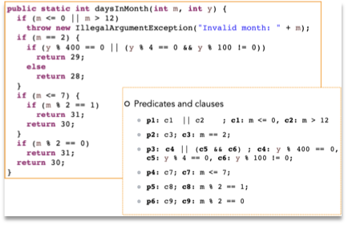

# Bài tập nhóm 22/11/2026 – Thiết kế test case và đánh giá độ bao phủ

| | |
|---|---|
| **Ngày giao** | 22/11/2026 (bài tập nhóm trên lớp) |
| **Nhóm** | 8 – danh sách thành viên: [`docs/info.md`](../../docs/info.md) |
| **Báo cáo** | [`report/`](report) → bản nộp `report/main.pdf` |
| **Phân công** | task T02–T07 trong [`docs/tasks.md`](../../docs/tasks.md) |

## Đề bài

1. Lấy ví dụ về đoạn mã có câu lệnh **điều kiện** (không quá đơn giản).
2. Thiết kế test case cho đoạn mã trên (có thể sử dụng tool – cho biết sử dụng tool gì).
3. Đánh giá mức độ bao phủ của test case đã thiết kế.
4. Đánh giá khả năng sinh test case từ các công cụ khác nhau, các tiêu chí khác nhau.
5. Kiểm tra lại bằng phân tích trực tiếp (thảo luận và đưa ra ý kiến của nhóm).

### Nội dung nộp

- Nhóm số
- Danh sách học viên tham gia
- Trả lời lần lượt các mục 1, 2, 3, 4, 5

Trang bìa và bảng "Thông tin nhóm" của báo cáo đã có sẵn hai phần đầu.

### Đối chiếu đề bài ↔ báo cáo

| Mục | Section trong `report/sections/content.tex` | Task | Thư mục liên quan |
|---|---|---|---|
| 1 | Ví dụ đoạn mã có câu lệnh điều kiện | T02 | `src/` |
| 2 | Thiết kế test case | T03 | `tests/` |
| 3 | Đánh giá mức độ bao phủ | T04 | `results/` |
| 4 | Đánh giá khả năng sinh test của các công cụ / tiêu chí | T05 | `results/` |
| 5 | Kiểm tra lại bằng phân tích trực tiếp | T06 | – |

## Ví dụ minh hoạ của giảng viên

Ảnh gốc: [`assets/vi-du-days-in-month.png`](assets/vi-du-days-in-month.png). Đây là ví dụ **mẫu** để tham khảo
mức độ "không quá đơn giản" – nhóm cần tự chọn đoạn mã của mình cho mục 1.



Mã nguồn trong ảnh (chép lại):

```java
public static int daysInMonth(int m, int y) {
    if (m <= 0 || m > 12)
        throw new IllegalArgumentException("Invalid month: " + m);
    if (m == 2) {
        if (y % 400 == 0 || (y % 4 == 0 && y % 100 != 0))
            return 29;
        else
            return 28;
    }
    if (m <= 7) {
        if (m % 2 == 1)
            return 31;
        return 30;
    }
    if (m % 2 == 0)
        return 31;
    return 30;
}
```

Predicate và clause (theo ảnh):

| Predicate | Biểu thức | Clause |
|---|---|---|
| p1 | c1 \|\| c2 | c1: `m <= 0`, c2: `m > 12` |
| p2 | c3 | c3: `m == 2` |
| p3 | c4 \|\| (c5 && c6) | c4: `y % 400 == 0`, c5: `y % 4 == 0`, c6: `y % 100 != 0` |
| p4 | c7 | c7: `m <= 7` |
| p5 | c8 | c8: `m % 2 == 1` |
| p6 | c9 | c9: `m % 2 == 0` |
